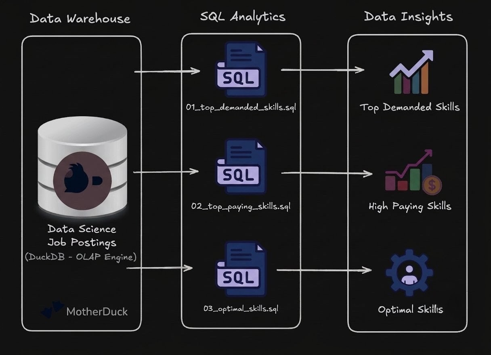

# Exploratory Data Analysis w/ SQL: Job Market Analysis 

A SQL project analyzing the data engineer job market using real world job posting data. It demonstrates my ability to **write production-quality analytical SQL, design efficient queries, and turn business questions into data-driven insights**

## Overview
- **Project scope:** Built **3 analytical queries** That answer key queations about the data angineer job market  
-**Data modeling:** Used **multi-table joins** across fact and dimension table to extract insights  
-**Analytics:** Applied **aggregations,filtering,and sortings** to find top skills, demand and salary  
-**Outcomes:** Delivered **actionable insights** on SQL/Python dominance,cloud trends and salary patterns

#### For a direct look at the code: 

1. [`01_demand_skills.sql`](01_demand_skills.sql) – demand analysis with multi-table joins
2. [`02_top_paying_skills.sql`](02_top_paying_skills.sql) – salary analysis with aggregations
3. [`03_optimal__skills.sql`](03_optimal__skills.sql) – combined demand/salary optimization query  
4. [`04_peru_data_engineer_skills.sql`](04_peru_data_engineer_skills.sql) – regional salary & demand analysis for remote roles in Peru

## Background & Objectives

#### Job market analysts need to answer questions like:

- **Most in-demand:** *Which skills are most in-demand for data engineers?*
- **Highest paid:** *Which skills command the highest salaries?*
- **Best trade-off:** *What is the optimal skill set balancing demand and compensation?*
- **Regional market (Peru):** *Which high-demand skills pay the most for remote data engineers in Peru, and how do salary disclosures impact results?*

#### This project analyzes a data warehouse built using a star schema design. The warehouse structure consists of:

- **Fact Table:** `job_postings_fact` – The central hub holding individual job listing records, including key details like titles, locations, salaries, and posting dates.
- **Dimension Tables:**
  - `company_dim` – Reference data containing company names and profile details linked to each listing.
  - `skills_dim` – The master catalog defining the names and categories of all technical skills.
- **Bridge Table:** `skills_job_dim` – A mapping table designed to resolve the many-to-many relationship connecting job posts with their required skills.

## Tools & Technologies  
- **Query Engine:** DuckDB for fast OLAP-style
analytical queries  
- **Language:** SQL (ANSI-style with analytical functions)  
- **Data Model:** Star schema with fact + dimension + bridge tables   
- **Devlopment:** VS Code for SQL editing + Terminal for DuckDB CLI  
- **Version Control:** Git/GitHub for versioned SQL scripts 

## Approach & Insights

### Query Structure

1. **[Top Demanded Skills](./01_demand_skills.sql)** — Identifies the 10 most in-demand skills for remote data engineer positions
2. **[Top Paying Skills](./02_top_paying_skills.sql)** — Analyzes the 25 highest-paying skills with salary and demand metrics
3. **[Optimal Skills](03_optimal__skills.sql)** — Calculates an optimal score using natural log of demand combined with median salary to identify the most valuable skills to learn  
4. **[Top Paying Skills in Peru](04_peru_data_engineer_skills.sql)** — Evaluates median salaries and demand (>100 postings) specifically for remote data engineer roles in Peru  

### Key Insights

* Core languages: SQL and Python each appear in ~29,000 job postings, making them the most demanded skills
* Cloud platforms: AWS and Azure are critical for modern data engineering roles
* Infra & tooling: Kubernetes, Docker, and Terraform are associated with premium salaries
* Big data tools: Apache Spark shows strong demand with competitive compensation  
* Regional insights (Peru): SQL, Python, and Flow lead disclosed remote salaries at a $27,000 median, while high-demand tools like Airflow (405 postings) and AWS (379 postings) return `NULL` medians due to missing salary disclosures in regional listings  

## SQL Implementation  
### Query Design & Optimization

* **Complex Joins**: Multi-table `INNER JOIN` operations across `job_postings_fact`, `company_dim`, `skills_job_dim`, and `skills_dim`
* **Aggregations**: `COUNT()`, `MEDIAN()`, `ROUND()` for statistical analysis
* **Filtering**: Boolean logic with `WHERE` clauses and multiple conditions (`job_title_short`, `job_work_from_home`, `salary_year_avg IS NOT NULL`)
* **Sorting & Limiting**: `ORDER BY` with `DESC` and `LIMIT` for top-N analysis  

### Data Analysis Techniques

* **Grouping**: `GROUP BY` for categorical analysis by skill
* **Conditional Logic**: `CASE WHEN` statements for derived metrics
* **Mathematical Functions**: `LN()` for natural logarithm transformation to normalize demand metrics
* **Calculated Metrics**: Derived optimal score combining log-transformed demand with median salary
* **HAVING Clause**: Filtering aggregated results (skills with $\ge 100$ postings)
* **NULL Handling**: Proper filtering of incomplete records (`salary_year_avg IS NOT NULL`)  